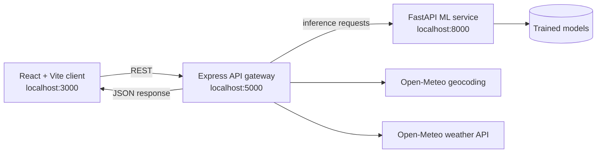

<div align="center">

# AeroCast AI

### Machine-learning weather forecasting with an interactive 3D atmosphere

<p>
  
  
  
  
  
  
</p>

<p>
  A full-stack weather application that combines live Open-Meteo observations,
  trained XGBoost and LightGBM models, and WebGL-based atmospheric visualizations.
</p>

</div>

---

## Contents

- [Overview](#overview)
- [Features](#features)
- [Architecture](#architecture)
- [Technology stack](#technology-stack)
- [Machine-learning pipeline](#machine-learning-pipeline)
- [Model results](#model-results)
- [Project structure](#project-structure)
- [Getting started](#getting-started)
- [Configuration](#configuration)
- [API reference](#api-reference)
- [Development workflow](#development-workflow)
- [Limitations](#limitations)
- [Acknowledgements](#acknowledgements)

## Overview

AeroCast AI is a weather forecasting project built around three services:

1. **React client** - the dashboard, charts, weather cards, and 3D scenes.
2. **Node.js/Express server** - the API gateway, geocoding proxy, caching layer,
   rate limiter, and service orchestrator.
3. **Python/FastAPI ML service** - model inference, 24-hour forecasting, health
   checks, and evaluation metrics.

The application uses Open-Meteo for geocoding and current/historical weather
observations. The machine-learning service uses those observations and its
trained models to estimate the next hour and generate a 24-hour forecast.

> **Note:** This is an educational and portfolio project. Model predictions are
> not a replacement for official weather warnings or professional meteorological
> services.

## Features

- City search with geocoding autocomplete.
- Live weather conditions and location metadata.
- Next-hour predictions for:
  - temperature
  - relative humidity
  - wind speed
  - surface pressure
  - rain probability and rain/no-rain classification
- 24-hour forecast chart.
- Model metrics and evaluation summary in the dashboard.
- Interactive 3D visualizations:
  - Planetary Radar Digital Twin globe.
  - LiDAR Atmospheric Sounding Chamber.
- In-memory caching for repeated requests.
- Express rate limiting.
- FastAPI Swagger documentation at `/docs`.
- Celsius/Fahrenheit display support in the client.

## Architecture



### Forecast request flow

1. The user searches for a city in the React client.
2. Express forwards the search to the Open-Meteo geocoding API.
3. Express retrieves current weather and recent history for the selected
   coordinates.
4. The Python service engineers lag, rolling, cyclical, and atmospheric
   features.
5. The trained models produce next-hour predictions and the 24-hour forecast.
6. Express combines live data, predictions, and 3D scene settings into one
   response for the client.

## Technology stack

### Frontend

- React 18
- Vite 6
- Three.js
- React Three Fiber and Drei
- Recharts
- Framer Motion
- Lucide React

### Backend

- Node.js
- Express
- Axios
- CORS
- Dotenv
- Express Rate Limit

### Machine learning

- Python
- FastAPI and Uvicorn
- Pandas and NumPy
- Scikit-learn
- XGBoost
- LightGBM
- Joblib
- Matplotlib and Jupyter

## Machine-learning pipeline

The included dataset contains hourly ERA5-derived observations from six
reference cities: London, New York, Tokyo, Mumbai, Berlin, and Sydney.

### Feature engineering

The training pipeline includes:

- Cyclical hour, month, and day-of-year encodings.
- Temperature, humidity, pressure, wind, and rain lag features.
- Three-hour pressure tendency.
- Dew-point depression.
- Six-hour rolling temperature statistics.
- Chronological train/test splitting to reduce time-series leakage.

### Models

| Prediction | Model |
| --- | --- |
| Temperature | XGBoost regressor |
| Relative humidity | XGBoost regressor |
| Wind speed | LightGBM regressor |
| Surface pressure | XGBoost regressor |
| Rain occurrence | Weighted XGBoost classifier |

The rain classifier uses a weighted objective to address the lower frequency of
rain events in the training data.

## Model results

The following results are recorded in the project evaluation artifacts. They
were measured on a chronological out-of-time test set of 10,482 samples.

### Regression

| Target | Model | MAE | RMSE | R2 |
| --- | --- | ---: | ---: | ---: |
| Temperature | XGBoost | 0.479 C | 0.689 C | 0.9943 |
| Relative humidity | XGBoost | 2.572% | 3.756% | 0.9497 |
| Wind speed | LightGBM | 1.856 km/h | 2.678 km/h | 0.8727 |
| Surface pressure | XGBoost | 0.429 hPa | 1.393 hPa | 0.9819 |

### Rain classification

| Metric | Weighted XGBoost |
| --- | ---: |
| Accuracy | 86.56% |
| ROC-AUC | 0.9321 |
| Recall | 82.53% |
| Precision | 53.06% |
| F1 score | 0.6459 |

More detailed results are available in
[`ml-service/models/evaluation_summary.md`](ml-service/models/evaluation_summary.md)
and [`ml-service/models/metrics.json`](ml-service/models/metrics.json).

## 3D visualizations

### Planetary Radar Digital Twin

The globe view provides a stylized WebGL representation of global atmospheric
context. It includes procedural continents, wind bands, a satellite-style radar
object, a radar sweep, and a location beacon based on latitude and longitude.

### LiDAR Atmospheric Sounding Chamber

The sounding view represents a vertical atmospheric column above the selected
location. It includes:

- 850 hPa, 700 hPa, and 500 hPa reference levels.
- A moving scan ring.
- Wind and precipitation particle effects.
- Different visual states for clear weather, rain, snow, and storms.

These scenes are explanatory visualizations rather than direct satellite or
radar measurements.

## Project structure

```text
.
├── client/
│   ├── src/
│   │   ├── components/
│   │   │   ├── objects/              # 3D scene objects
│   │   │   ├── ForecastChart.jsx
│   │   │   ├── MetricsModal.jsx
│   │   │   ├── Scene3D.jsx
│   │   │   ├── SearchBar.jsx
│   │   │   └── WeatherCard.jsx
│   │   ├── hooks/useWeather.js
│   │   ├── services/api.js
│   │   ├── styles/theme.css
│   │   ├── App.jsx
│   │   └── main.jsx
│   ├── package.json
│   └── vite.config.js
├── server/
│   ├── src/
│   │   ├── controllers/weather.controller.js
│   │   ├── middleware/
│   │   ├── routes/weather.routes.js
│   │   ├── services/
│   │   ├── app.js
│   │   └── server.js
│   ├── .env.example
│   └── package.json
├── ml-service/
│   ├── data/
│   ├── models/
│   ├── notebooks/eda.ipynb
│   ├── src/
│   │   ├── api.py
│   │   ├── download_data.py
│   │   ├── evaluate.py
│   │   ├── preprocess.py
│   │   └── train.py
│   └── requirements.txt
├── run_all.bat
└── README.md
```

## Getting started

### Prerequisites

- Git
- Node.js 18 or later
- npm
- Python 3.10 or later
- A virtual environment is recommended for Python dependencies.

### 1. Clone the repository

```bash
git clone https://github.com/yashmanglamsoniiiii/Weather_Dyamic_forecast_clg_project.git
cd Weather_Dyamic_forecast_clg_project
```

### 2. Install the dependencies

#### Python ML service

```bash
python -m venv .venv
```

On Windows:

```powershell
.venv\Scripts\Activate.ps1
```

On macOS/Linux:

```bash
source .venv/bin/activate
```

Then install the Python packages:

```bash
python -m pip install --upgrade pip
python -m pip install -r ml-service/requirements.txt
```

#### Node.js services

```bash
cd server
npm install

cd ../client
npm install

cd ..
```

### 3. Configure the server

Create `server/.env` from the included example:

```powershell
Copy-Item server\.env.example server\.env
```

For macOS/Linux:

```bash
cp server/.env.example server/.env
```

The default configuration uses:

| Service | URL |
| --- | --- |
| React client | http://localhost:3000 |
| Express server | http://localhost:5000 |
| FastAPI ML service | http://127.0.0.1:8000 |

### 4. Start the services

Start each service in a separate terminal from the project root.

#### Terminal 1: ML service

```bash
cd ml-service/src
python -m uvicorn api:app --host 127.0.0.1 --port 8000
```

#### Terminal 2: Express server

```bash
cd server
npm start
```

#### Terminal 3: React client

```bash
cd client
npm run dev
```

Open [http://localhost:3000](http://localhost:3000) after all three services
are running.

### Windows launcher

`run_all.bat` can start all three services on Windows. If the project is
located somewhere other than the path configured in that file, update the
project path in `run_all.bat` first. The manual commands above work on every
operating system.

## Configuration

The server reads configuration from `server/.env`:

```dotenv
PORT=5000
NODE_ENV=development
ML_SERVICE_URL=http://127.0.0.1:8000
GEOCODING_API_URL=https://geocoding-api.open-meteo.com/v1
OPENMETEO_API_URL=https://api.open-meteo.com/v1
CACHE_TTL_SECONDS=300
```

Do not commit `server/.env`. It is intentionally ignored by Git. Use
[`server/.env.example`](server/.env.example) as the shareable template.

## API reference

The Express API is available under `/api/weather`.

| Method | Endpoint | Description |
| --- | --- | --- |
| `GET` | `/api/weather/search?q=London` | Search for cities |
| `GET` | `/api/weather/forecast?city=London` | Get a forecast by city |
| `GET` | `/api/weather/forecast?lat=51.5&lon=-0.1` | Get a forecast by coordinates |
| `GET` | `/api/weather/metrics` | Get model metrics |
| `GET` | `/api/weather/health` | Check the API and ML service health |

The FastAPI service exposes interactive documentation at
[http://127.0.0.1:8000/docs](http://127.0.0.1:8000/docs).

### Example requests

```bash
curl "http://localhost:5000/api/weather/search?q=Tokyo"
curl "http://localhost:5000/api/weather/forecast?city=Tokyo"
curl "http://localhost:5000/api/weather/health"
```

Successful Express responses use the following general shape:

```json
{
  "success": true,
  "data": {}
}
```

## Development workflow

### Build the client

```bash
cd client
npm run build
```

The generated `client/dist` directory is a local build artifact and is ignored
by Git.

### Retrain or evaluate the models

The ML scripts are located in `ml-service/src`:

```bash
cd ml-service/src
python download_data.py
python preprocess.py
python train.py
python evaluate.py
```

Retraining can replace the model files in `ml-service/models`. Keep the
evaluation artifacts synchronized with the models used by the API.

## Limitations

- The service depends on Open-Meteo availability and response formats.
- The included models are trained on a limited set of reference cities and
  historical data; performance may vary for unseen locations and weather
  regimes.
- The 3D globe, radar, and LiDAR scenes are visual explanations, not live
  instrument feeds.
- The server cache is in memory and is cleared when the process restarts.
- No authentication or persistent user accounts are included.

## Acknowledgements

- [Open-Meteo](https://open-meteo.com/) for geocoding and weather data APIs.
- [Copernicus Climate Data Store](https://cds.climate.copernicus.eu/) and
  ERA5 reanalysis data.
- The open-source React, Three.js, FastAPI, XGBoost, LightGBM, and
  scikit-learn communities.
