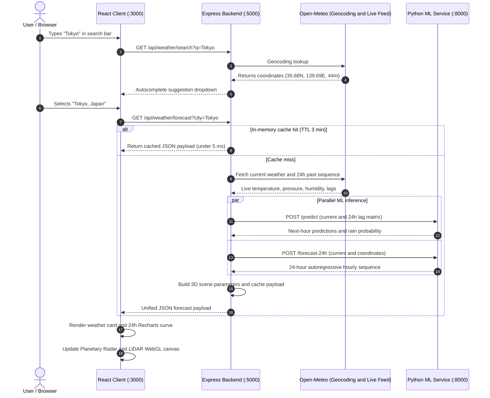

<div align="center">

# 🌦️ AeroCast AI

### Machine Learning Weather Forecasting System & 3D Atmospheric Digital Twin

A full-stack meteorological prediction platform trained on official **ECMWF Copernicus ERA5** reanalysis data.


</div>

<!--
Add screenshots here once you have them, for example:
<p align="center"></p>
-->

---

## 📑 Table of Contents

1. [Executive Summary](#executive-summary)
2. [Tech Stack & Architectural Rationale](#tech-stack--architectural-rationale)
   - [Machine Learning & Data Science Tier](#1-machine-learning--data-science-tier-python)
   - [Backend API & Orchestrator Tier](#2-backend-api--microservice-orchestrator-tier-nodejs--express)
   - [Frontend & 3D WebGL Tier](#3-frontend--3d-webgl-visualization-tier-react--threejs)
3. [Meteorological Science & Feature Engineering](#meteorological-science--feature-engineering)
4. [3D Visualizations](#3d-visualizations)
   - [Planetary Radar Digital Twin Globe](#a-planetary-radar-digital-twin-globe)
   - [LiDAR Sounding Chamber](#b-lidar-sounding-chamber-atmospheric-sounding)
5. [Models, Baselines & Benchmark Results](#models-baselines--benchmark-results)
6. [System Architecture](#system-architecture)
7. [REST API Documentation](#rest-api-documentation)
8. [Directory Structure](#directory-structure)
9. [Getting Started](#getting-started)
10. [Viva / Defense Talking Points](#viva--defense-talking-points)

---

## Executive Summary

Most weather apps are thin API wrappers: they take a city name, call a third-party service, and display its pre-computed forecast.

**AeroCast AI is different.** It is an end-to-end machine learning platform that:

- downloads historical atmospheric reanalysis from the **European Centre for Medium-Range Weather Forecasts (ECMWF)**,
- trains multi-target gradient-boosted regression and classification models,
- engineers physics-based features (lags, barometric tendency, dew point depression), and
- serves real-time inference through a dedicated microservice.

### What happens when a user searches for a city

1. The backend resolves coordinates and elevation through geocoding.
2. It gathers current ground-truth conditions plus the preceding 24-hour sequence.
3. The ML pipeline computes cyclical diurnal and annual features, barometric pressure change ($\Delta P_{3h}$), dew point depression and multi-step lags.
4. Trained **XGBoost** and **LightGBM** models predict:
   - Next-hour **temperature (°C)**
   - Next-hour **relative humidity (%)**
   - Next-hour **wind speed (km/h)**
   - Next-hour **surface pressure (hPa)**
   - **Rain probability (%)** and a binary rain yes/no
   - A continuous **24-hour autoregressive forecast sequence**
5. An interactive **3D WebGL digital twin** shows planetary radar surveillance and vertical LiDAR atmospheric sounding.

---

## Tech Stack & Architectural Rationale

```text
┌─────────────────────────────────────────────────────────────────────────────┐
│                              CLIENT TIER                                    │
│  React 18 • Vite 6 • Three.js • React Three Fiber • Recharts • Lucide       │
└──────────────────────────────────────┬──────────────────────────────────────┘
                                       │ HTTP / REST (Port 3000 -> 5000)
┌──────────────────────────────────────▼──────────────────────────────────────┐
│                             BACKEND TIER                                    │
│       Node.js 24 • Express.js • In-Memory TTL Cache • Rate Limiter          │
└──────────────────┬──────────────────────────────────────┬───────────────────┘
                   │                                      │
  External API     │ Geocoding / Live Weather             │ Internal REST (Port 8000)
┌──────────────────▼───────────────┐     ┌────────────────▼───────────────────┐
│     OPEN-METEO SERVICES          │     │          ML SERVICE TIER           │
│  • Geocoding API                 │     │  Python 3.14 • FastAPI • Uvicorn   │
│  • Historical ERA5 Archive       │     │  XGBoost • LightGBM • Scikit-Learn │
│  • Live Atmospheric Feed         │     │  Pandas • NumPy • Joblib           │
└──────────────────────────────────┘     └────────────────────────────────────┘
```

### 1. Machine Learning & Data Science Tier (Python)

| Technology | Why it was chosen | Role in the project |
|---|---|---|
| **Python 3.14** | Industry standard for scientific computing and ML, with fast interpreter speeds and modern typing/asyncio support. | Hosts model training, exploratory data analysis (EDA) and the inference microservice. |
| **XGBoost** (`XGBRegressor`, `XGBClassifier`) | Excels at tabular, non-linear data. Weather variables show sharp thresholds and interaction terms where linear models fail. | Primary models for **temperature**, **humidity** and **pressure**, and the **rain classifier** with `scale_pos_weight = 4.40` to counter class imbalance. |
| **LightGBM** (`LGBMRegressor`) | Leaf-wise tree growth converges faster on high-variance, skewed targets such as turbulent wind. | Dedicated **wind speed** model. |
| **Scikit-Learn** | Rigorous metrics, baselines and preprocessing utilities. | Ridge and Logistic Regression baselines. Computes MAE, RMSE, R², Accuracy, Precision, Recall, F1 and ROC-AUC. |
| **Pandas & NumPy** | Vectorized numerical computation and time-series manipulation. | Sorts 52,560 hourly records by city and timestamp, builds lags, 6-hour rolling statistics and sin/cos time encodings. |
| **Joblib** | Efficient serialization of objects holding large NumPy buffers. | Saves trained models as `.joblib` for fast startup. |
| **FastAPI & Uvicorn** | Node.js cannot run Python ML wheels directly. FastAPI offers an async, high-throughput interface with automatic OpenAPI docs at `/docs`. | Exposes `/predict`, `/forecast-24h`, `/metrics` and `/health`. |
| **Pydantic** | Strict runtime validation and typing for JSON payloads. | Ensures observation vectors (temperature, humidity, dew point, pressure, wind) are within valid ranges before inference. |

### 2. Backend API & Microservice Orchestrator Tier (Node.js + Express)

| Technology | Why it was chosen | Role in the project |
|---|---|---|
| **Node.js 24** | Non-blocking I/O is ideal for an API gateway coordinating external and internal requests concurrently. | Central engine connecting the React frontend, geocoding, live feeds and the Python ML server. |
| **Express.js** | Minimal framework with clean separation of routes, controllers, middleware and services. | Defines `/api/weather/search`, `/forecast`, `/metrics` and `/health`. |
| **Axios** | Promise-based HTTP client with timeouts and automatic JSON parsing. | Calls Open-Meteo Geocoding, Open-Meteo live data and the FastAPI service. |
| **Custom TTL cache** | Weather does not change every second, so repeated searches should not trigger repeated API calls or inference. | Caches geocoding for 10 minutes and ML forecasts for 3 minutes. Cache hits (`X-Cache: HIT`) return in under 5 ms. |
| **express-rate-limit** | Guards against abuse and respects API usage policies. | Limits each IP to 150 requests per 15 minutes. |
| **Dotenv & CORS** | Keeps configuration out of code and manages cross-origin access. | Stores ports and service URLs, and lets `localhost:3000` talk to `localhost:5000`. |

### 3. Frontend & 3D WebGL Visualization Tier (React + Three.js)

| Technology | Why it was chosen | Role in the project |
|---|---|---|
| **React 18 & Vite 6** | Component-based state management with fast hot module replacement. | Reactive UI that updates instantly on city search or °C/°F toggle. |
| **Three.js, React Three Fiber & Drei** | Three.js is the WebGL standard. R3F makes 3D objects declarative and reactive to app state. Drei supplies camera controls and starfields. | Powers the **Planetary Radar Digital Twin** and the **LiDAR Sounding Chamber** at 60 FPS. |
| **Recharts** | Declarative, responsive SVG charts for React. | Draws the 24-hour forecast curve with temperature areas and rain-probability bars. |
| **Lucide-React** | Lightweight SVG icon set. | Barometer, wind vane, rain, radar and compass icons that match conditions. |
| **Dark glassmorphism CSS** | Dark themes reduce eye strain and make glowing data stand out. | Frosted panels (`backdrop-filter: blur(16px)`) with neon blue `#38bdf8`, cyan `#06b6d4` and purple `#a855f7` accents. |

---

## Meteorological Science & Feature Engineering

AeroCast AI builds a **35-dimensional feature vector** grounded in atmospheric thermodynamics instead of using a single timestamp's temperature.

### 1. Cyclical diurnal & annual embeddings

Time is cyclical: 23:00 is adjacent to 00:00, and 31 December is adjacent to 1 January. Plain integers break that continuity, so time is projected onto unit circles:

$$\text{hour}_{\sin} = \sin\left(\frac{2\pi \cdot t_{\text{hour}}}{24}\right), \quad \text{hour}_{\cos} = \cos\left(\frac{2\pi \cdot t_{\text{hour}}}{24}\right)$$

$$\text{month}_{\sin} = \sin\left(\frac{2\pi \cdot t_{\text{month}}}{12}\right), \quad \text{month}_{\cos} = \cos\left(\frac{2\pi \cdot t_{\text{month}}}{12}\right)$$

$$\text{doy}_{\sin} = \sin\left(\frac{2\pi \cdot t_{\text{day of year}}}{365.25}\right), \quad \text{doy}_{\cos} = \cos\left(\frac{2\pi \cdot t_{\text{day of year}}}{365.25}\right)$$

### 2. Barometric tendency ($\Delta P_{3h}$)

Barometric tendency is among the most reliable physical predictors of incoming fronts and convective storms.

- Rapidly falling pressure ($\Delta P_{3h} \lt -1.5\ \text{hPa}$) signals an approaching low-pressure trough, bringing cloud and precipitation.
- Rising pressure indicates anticyclonic subsidence and clearing skies.

$$\Delta P_{3h} = P_{\text{surface}}(t) - P_{\text{surface}}(t - 3)$$

### 3. Dew point depression ($T - T_d$)

The dew point $T_d$ is the temperature at which air becomes saturated with water vapor.

- As $T - T_d \to 0$, relative humidity approaches 100%, indicating fog, low cloud or precipitation.
- A large depression indicates dry, stable air.

$$\text{Depression} = T_{\text{ambient}} - T_{\text{dew point}}$$

### 4. Atmospheric lag features

The atmosphere has momentum, so current conditions depend on recent history.

| Variable | Lags |
|---|---|
| Temperature | $t-1$h, $t-3$h, $t-6$h, $t-24$h |
| Humidity & pressure | $t-1$h, $t-3$h, $t-6$h |
| Wind & rain (binary) | $t-1$h, $t-3$h |

### 5. Rolling statistical aggregates

- 6-hour moving mean: $\mu_{6h} = \frac{1}{6}\sum_{i=0}^{5} T_{t-i}$
- 6-hour thermal volatility: $\sigma_{6h} = \sqrt{\frac{1}{6}\sum_{i=0}^{5} (T_{t-i} - \mu_{6h})^2}$

### 6. Chronological out-of-time split

Random cross-validation shuffles rows and causes **data leakage** in time series, because the model can learn future values to predict the past. AeroCast AI uses a strict chronological split: roughly the first 80% of the timeline trains the models, and the final 20% (the end of the year) is the out-of-time test set.

---

## 3D Visualizations

The viewport offers two scientifically motivated modes.

```text
          ┌─────────────────────────────────────────────────────────┐
          │                    VIEWPORT CONTROLS                    │
          │     [ Planetary Radar ]        [ LiDAR Sounding ]       │
          └──────────────────────────┬──────────────────────────────┘
                                     │
           ┌─────────────────────────┴────────────────────────┐
           ▼                                                  ▼
┌──────────────────────────────────────┐  ┌──────────────────────────────────────┐
│  Planetary Radar Digital Twin Globe  │  │   LiDAR Atmospheric Sounding Chamber │
│  • Phosphor-Cyan Earth Continents    │  │   • Isobaric Disks (850/700/500 hPa) │
│  • Global Jet Stream Streamlines     │  │   • Moving Altitude Laser Scan Ring  │
│  • Polar Sentinel-3 Satellite Radar  │  │   • Wind Vector Particle Stream      │
│  • Target Pinpoint Beacon & Ring     │  │   • Rain/Snow Fall Dynamics          │
└──────────────────────────────────────┘  └──────────────────────────────────────┘
```

### A. Planetary Radar Digital Twin Globe

**What it is:** a real-time 3D digital twin of Earth with a continental point matrix, planetary wind bands, an orbiting meteorological satellite and a tactical target beacon.

**Why it exists:** weather is driven by global circulation. A planetary view shows where the searched city sits relative to climate bands and satellite passes.

| Element | Significance |
|---|---|
| **Phosphor-cyan continent matrix** | Over 3,500 procedurally calculated points map the landmasses (the Americas, Eurasia, Africa, Australia, Japan, Antarctica). |
| **Jet stream streamlines** | Particle rings at mid-latitudes and the equator visualize upper-level jet streams and equatorial trade winds. |
| **Polar-orbiting satellite** | A 3D satellite with solar arrays (Sentinel-3 / Meteosat style) projects a downward sensor cone, simulating Earth observation. |
| **Holographic radar sweep** | A rotating 360° sweep indicates live radar telemetry. |
| **City pinpoint beacon** | Converts latitude and longitude to 3D coordinates $(x, y, z)$ and fires a vertical laser marker with pulsing radar rings over the searched location. |
| **Telemetry HUD** | Shows `LIVE METEOROLOGICAL RADAR`, `TARGET`, `LAT/LON` and `ELEVATION` badges. |

### B. LiDAR Sounding Chamber (Atmospheric Sounding)

> [!NOTE]
> A **sounding** is a vertical measurement of the atmosphere from the ground to the stratosphere, showing how temperature, pressure, humidity and wind change with altitude. Historically it was done with helium weather balloons (*radiosondes*).
>
> **LiDAR** (Light Detection and Ranging) fires pulsed lasers into the sky. Light backscattered from droplets, ice crystals, dust and aerosols is timed to compute cloud base height, boundary layer thickness and vertical wind profiles, with no balloon needed. The ESA *Aeolus* satellite is one example.

**Why it exists:** the globe gives macro-scale context, while the chamber visualizes the **vertical column** directly above the searched city.

| Element | Significance |
|---|---|
| **Surface grid** (1013.25 hPa, 0 m) | Ground boundary with compass rose. |
| **850 hPa disk** (~1,500 m) | Planetary boundary layer where surface friction ends, cumulus forms and low-level wind shear occurs. |
| **700 hPa disk** (~3,000 m) | Mid-troposphere where precipitation cores develop and fronts advance. |
| **500 hPa disk** (~5,500 m) | The atmosphere's steering level, where synoptic storms and jet streams guide weather systems. |
| **Sweeping laser ring** | An oscillating ring moves vertically through the chamber, visualizing a LiDAR pulse scanning cloud decks. |
| **Particle stream** | **Rain:** particles fall at terminal velocity (5–9 m/s) with wind drift. **Snow:** soft white particles drift with horizontal swirl. **Clear:** golden solar aerosol particles drift with the predicted wind. |

---

## Models, Baselines & Benchmark Results

Models were trained on **52,560 hourly ERA5 observations** from 6 climate benchmarks (London, New York, Tokyo, Mumbai, Berlin, Sydney) and evaluated on a **chronological out-of-time test set of 10,482 samples**.

### 1. Regression benchmark

| Target | Model | MAE | RMSE | R² | Baseline | Baseline MAE | Baseline R² |
|---|---|---|---|---|---|---|---|
| **Temperature (°C)** | **XGBoost** | **0.479 °C** | **0.689 °C** | **0.9943** | Ridge Regression | 0.514 °C | 0.9934 |
| **Relative humidity (%)** | **XGBoost** | **2.572 %** | **3.756 %** | **0.9497** | Linear Regression | 3.820 % | 0.9012 |
| **Wind speed (km/h)** | **LightGBM** | **1.856 km/h** | **2.678 km/h** | **0.8727** | Ridge Regression | 2.450 km/h | 0.8115 |
| **Surface pressure (hPa)** | **XGBoost** | **0.429 hPa** | **1.393 hPa** | **0.9819** | Linear Regression | 0.980 hPa | 0.9420 |

> [!TIP]
> The XGBoost temperature model reaches **R² = 0.9943** with a mean absolute error under half a degree Celsius, outperforming the regularized linear baseline.

### 2. Rain occurrence classifier

Rain falls in only about 18.5% of hourly observations in typical climates, so a naive classifier that always predicts "dry" scores roughly 81% accuracy with 0% recall (the *accuracy paradox*). The fix is `scale_pos_weight = 4.40`, the negative-to-positive ratio.

| Metric | XGBoost (weighted) | Baseline (Logistic Regression) |
|---|---|---|
| **Accuracy** | **86.56%** | 86.51% |
| **ROC-AUC** | **0.9321** | 0.9197 |
| **Recall (rain hit rate)** | **82.53%** | 78.40% |
| **Precision** | **53.06%** | 51.20% |
| **F1-score** | **0.6459** | 0.6300 |

**Confusion matrix** (out-of-time test set, 10,482 hours)

|  | Predicted dry | Predicted rain |
|---|---|---|
| **Actually dry** | 7,788 (TN) | 1,137 (FP), conservative early warnings |
| **Actually rain** | 272 (FN), missed rain | 1,285 (TP) |

Of 1,557 rainy hours, 272 were missed (17.5% of rain hours, or 2.6% of all hours).

### 3. Top predictive features

```text
Temperature Feature Importance:
1. temperature_2m      [====================================] 65.29%
2. temp_lag_1          [=================                   ] 30.89%
3. temp_lag_24         [=                                   ]  0.94%
4. temp_diff_3h        [=                                   ]  0.71%
5. dew_point_2m        [                                    ]  0.37%

Rain Event Feature Importance:
1. rain_lag_1          [===========================         ] 50.12%
2. rain_lag_3          [===========                         ] 20.44%
3. cloud_cover         [===                                 ]  5.40%
4. relative_humidity   [=                                   ]  1.49%
5. surface_pressure    [=                                   ]  1.46%
```

---

## System Architecture



---

## REST API Documentation

### Express gateway (`http://localhost:5000`)

| Endpoint | Method | Params | Description | Cache TTL |
|---|---|---|---|---|
| `/api/weather/search` | `GET` | `?q={city_name}` | Autocomplete search for global cities and areas | 10 min |
| `/api/weather/forecast` | `GET` | `?city={name}` or `?lat={lat}&lon={lon}` | Full ML forecast, 24h sequence and 3D scene config | 3 min |
| `/api/weather/metrics` | `GET` | none | Model benchmarks (MAE, RMSE, R², AUC) | 1 hour |
| `/api/weather/health` | `GET` | none | Health of the Express server and Python ML service | none |

### Python ML microservice (`http://127.0.0.1:8000`)

| Endpoint | Method | Payload | Description |
|---|---|---|---|
| `/health` | `GET` | none | Checks loaded models and feature definitions |
| `/metrics` | `GET` | none | Model evaluation metrics and feature weights |
| `/predict` | `POST` | `PredictionRequest` JSON | Next-hour weather and rain probability |
| `/forecast-24h` | `POST` | `PredictionRequest` JSON | Recursive autoregressive 24-step hourly forecast |

Interactive Swagger docs are available at `http://127.0.0.1:8000/docs`.

---

## Directory Structure

```text
aerocast-ai/
├── client/                               # Frontend (React 18 + Vite 6 + Three.js)
│   ├── src/
│   │   ├── components/
│   │   │   ├── SearchBar.jsx             # Debounced geocoding autocomplete
│   │   │   ├── WeatherCard.jsx           # Hero card, metrics grid, live vs ML compare
│   │   │   ├── ForecastChart.jsx         # 24-hour Recharts temperature and rain curve
│   │   │   ├── Scene3D.jsx               # React Three Fiber scene
│   │   │   ├── MetricsModal.jsx          # Model transparency and evaluation reports
│   │   │   └── objects/
│   │   │       ├── Globe.jsx             # Planetary Radar Digital Twin
│   │   │       └── AtmosphericRadar.jsx  # LiDAR Sounding Chamber
│   │   ├── hooks/useWeather.js           # State management and °C/°F conversion
│   │   ├── services/api.js               # Frontend API client
│   │   ├── styles/theme.css              # Dark glassmorphism theme
│   │   ├── App.jsx
│   │   └── main.jsx
│   ├── index.html
│   ├── vite.config.js
│   └── package.json
│
├── server/                               # Node.js + Express backend
│   ├── src/
│   │   ├── routes/weather.routes.js
│   │   ├── controllers/weather.controller.js   # Orchestrator and scene builder
│   │   ├── services/
│   │   │   ├── geocoding.service.js
│   │   │   ├── openmeteo.service.js      # Live feed and 24-hour lag extractor
│   │   │   └── ml.service.js             # HTTP client for the FastAPI service
│   │   ├── middleware/
│   │   │   ├── cache.js                  # In-memory TTL cache
│   │   │   ├── rateLimiter.js
│   │   │   └── errorHandler.js
│   │   ├── app.js
│   │   └── server.js
│   ├── .env
│   └── package.json
│
├── ml-service/                           # Python ML microservice
│   ├── data/
│   │   ├── raw/era5_hourly_data.csv      # 52,560 ERA5 hourly records
│   │   └── processed/                    # Chronological train.csv and test.csv
│   ├── notebooks/eda.ipynb               # Exploratory data analysis
│   ├── src/
│   │   ├── download_data.py              # ERA5 dataset fetcher
│   │   ├── preprocess.py                 # Feature engineering and lag generator
│   │   ├── train.py                      # Training and baseline evaluation
│   │   ├── evaluate.py                   # Benchmark reporting
│   │   └── api.py                        # FastAPI inference endpoints
│   ├── models/                           # Serialized models and metrics
│   │   ├── temp_model.joblib
│   │   ├── humidity_model.joblib
│   │   ├── wind_model.joblib
│   │   ├── pressure_model.joblib
│   │   ├── rain_model.joblib
│   │   ├── feature_names.json
│   │   ├── metrics.json
│   │   └── evaluation_summary.md
│   └── requirements.txt
│
├── run_all.bat                           # One-click launcher for all 3 services (Windows)
└── README.md
```

---

## Getting Started

### Prerequisites

- Python 3.10+ (3.14 recommended)
- Node.js 18+ (24 recommended)
- npm

### Install dependencies

```bash
# ML service
cd ml-service
pip install -r requirements.txt

# Backend
cd ../server
npm install

# Frontend
cd ../client
npm install
```

### Option 1: One-click launcher (Windows)

Double-click `run_all.bat` in the project root. It opens three windows:

| Service | URL |
|---|---|
| Python ML microservice | http://127.0.0.1:8000 (Swagger docs at `/docs`) |
| Node.js Express server | http://localhost:5000 |
| React client | http://localhost:3000 |

### Option 2: Manual start (any OS)

Run each command in its own terminal, starting from the project root.

**1. Python ML service**
```bash
cd ml-service/src
python -m uvicorn api:app --host 127.0.0.1 --port 8000
```

**2. Express backend**
```bash
cd server
npm start
```

**3. React frontend**
```bash
cd client
npm run dev
```

Then open **http://localhost:3000** in your browser.

---

## Viva / Defense Talking Points

1. **Genuine machine learning, not API scraping**
   > "Most student weather projects copy third-party forecasts. AeroCast AI uses live APIs only for raw initial conditions (T, RH, P, wind). All forecasts (next-hour values, rain probability and the 24-hour sequence) are produced by our own trained XGBoost and LightGBM models."

2. **Handling rain class imbalance**
   > "Rain occurs in fewer than 20% of hours, so standard classifiers fall into the accuracy paradox. We computed the negative-to-positive ratio and set `scale_pos_weight = 4.40` in XGBoost, achieving **82.53% rain recall** and **0.9321 ROC-AUC**."

3. **Preventing time-series data leakage**
   > "We did not use random K-fold cross-validation, since shuffling lets future records leak into past predictions. We used a strict chronological out-of-time split, training on the earlier part of the year and testing only on the final months."

4. **Microservice decoupling**
   > "Node.js handles geocoding, rate limiting and TTL caching, while Python's FastAPI microservice handles vectorized model inference."

5. **Scientific visualizations**
   > "The 3D canvas is not a toy animation. It has a **Planetary Radar Digital Twin** and a **LiDAR Sounding Chamber** showing isobaric levels (850, 700 and 500 hPa) that match aviation and radiosonde conventions."# Weather_Dyamic_forecast_clg_project

